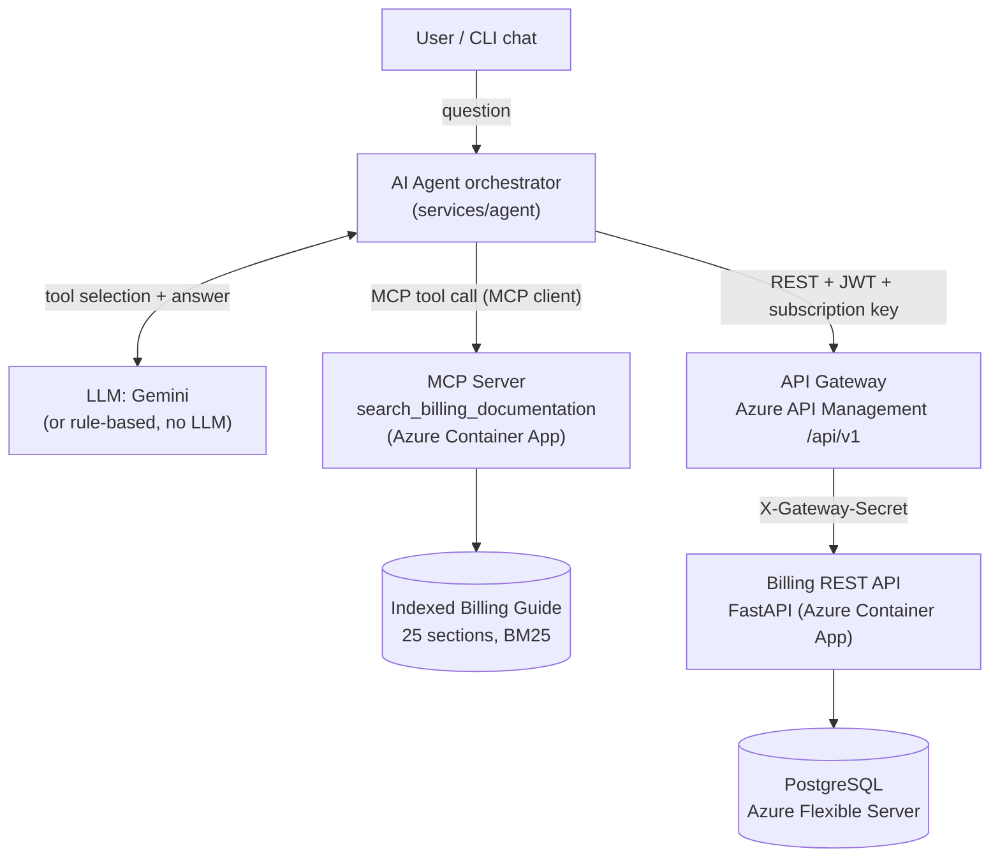
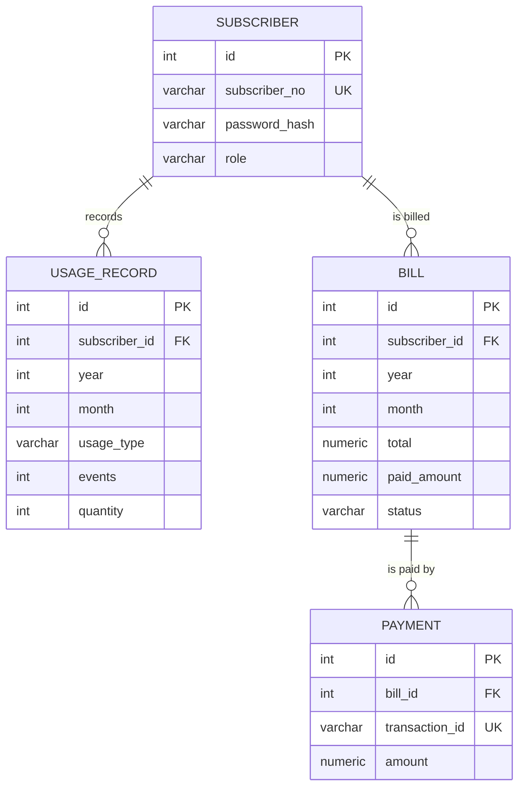

# AI Billing Support Assistant — SE4458 Midterm (Group 2)

A conversational assistant for mobile subscribers. It answers questions about billing rules, current
bills, detailed usage and payments, and decides per question whether to use the **MCP documentation
tool**, the **Billing REST API** (through an **API Gateway**), or both.

- **Stack:** Python 3.12 · FastAPI · SQLAlchemy/Alembic · PostgreSQL · official MCP Python SDK · Google Gemini · pytest
- **Cloud:** Microsoft Azure (Azure for Students): API Management, Container Apps, PostgreSQL Flexible Server, Container Registry
- **Interface:** command-line chat

---

## Contents

1. [Architecture](#1-architecture)
2. [Deployed URLs](#2-deployed-urls)
3. [Repository layout](#3-repository-layout)
4. [Run it locally](#4-run-it-locally)
5. [Test accounts and data](#5-test-accounts-and-data)
6. [REST API](#6-rest-api)
7. [API Gateway](#7-api-gateway)
8. [Authentication and authorization](#8-authentication-and-authorization)
9. [Billing business logic](#9-billing-business-logic)
10. [Data model (ER)](#10-data-model-er)
11. [MCP server and indexing](#11-mcp-server-and-indexing)
12. [AI agent and LLM tool calling](#12-ai-agent-and-llm-tool-calling)
13. [LLM cost and low-cost approach](#13-llm-cost-and-low-cost-approach)
14. [Unit tests](#14-unit-tests)
15. [Cloud deployment](#15-cloud-deployment)
16. [Assumptions](#16-assumptions)
17. [Reproducing the results (for the instructor)](#17-reproducing-the-results-for-the-instructor)
18. [Evidence index](#18-evidence-index)

---

## 1. Architecture

*AI Agent ↔ LLM; AI Agent → API Gateway → Billing REST API → Database;
AI Agent (MCP Client) → MCP Server → indexed billing guide. The agent executes all tool calls.*



| Service | Folder | Role |
|---|---|---|
| Billing REST API | [`services/billing_api`](services/billing_api) | Usage, bill calculation, bill queries, payments, login (JWT) |
| MCP server | [`services/mcp_server`](services/mcp_server) | Indexes the billing guide, exposes `search_billing_documentation` |
| AI agent | [`services/agent`](services/agent) | CLI chat; LLM chooses tools, the agent executes them and enforces safety rules |

All three are independent services, each with its own dependencies, tests and (for the two servers) Docker image.

## 2. Deployed URLs

| What | URL |
|---|---|
| **API Gateway (use this)** | `https://apim-billing-na3xi.azure-api.net/api/v1` |
| MCP server (streamable HTTP) | `https://ca-billing-mcp.nicedune-430dff91.polandcentral.azurecontainerapps.io/mcp` |
| Swagger UI (documentation) | `https://ca-billing-api.nicedune-430dff91.polandcentral.azurecontainerapps.io/docs` |
| Health checks | `.../health` on both Container Apps |

- The Billing API backend rejects calls that do not come through the gateway (`403 GATEWAY_REQUIRED`);
  only `/health`, `/docs` and `/openapi.json` are open. Swagger's "Try it out" therefore works only locally.
- Apps scale to zero when idle: the **first request after a pause can take 20–30 s** (cold start).
- Regions: everything in **Poland Central**, except API Management in **Norway East** (Consumption tier is
  not offered in Poland Central or Switzerland North for this subscription; see [§15](#15-cloud-deployment)).

## 3. Repository layout

```
services/
  billing_api/   FastAPI app, Alembic migrations, seed data, Dockerfile, tests/
  mcp_server/    MCP server, indexer, data/Mobile_Provider_Billing_Guide.md, Dockerfile, tests/
  agent/         Agent loop, tools, Gemini + rule-based providers, CLI, tests/
infra/azure/     Deployment scripts (01..07) and their README
docs/            ER diagram, OpenAPI spec, LLM cost notes, logs/ (evidence)
docker-compose.yml  Local PostgreSQL
```

## 4. Run it locally

Prerequisites: [uv](https://docs.astral.sh/uv/) (installs Python 3.12 automatically) and Docker Desktop.

```bash
# 1. Database (PostgreSQL 16 on localhost:5433)
docker compose up -d

# 2. Billing API: create tables, load demo data, start (terminal 1)
cd services/billing_api
uv run alembic upgrade head
uv run python -m app.seed
uv run uvicorn app.main:app --port 8000        # Swagger UI: http://localhost:8000/docs

# 3. MCP server (terminal 2)
cd services/mcp_server
uv run python -m billing_docs.server           # http://127.0.0.1:8001/mcp

# 4. Agent chat (terminal 3)
cd services/agent
cp .env.example .env                           # defaults: local services, rule-based (no LLM)
uv run python -m billing_agent.cli --trace     # then: /login 5551001
```

To use Gemini, set `LLM_PROVIDER=gemini` and `GEMINI_API_KEY=...` in `services/agent/.env`
(see [§13](#13-llm-cost-and-low-cost-approach)). To use the cloud, set `API_BASE_URL`, `MCP_URL` and
`APIM_SUBSCRIPTION_KEY` (see [§17](#17-reproducing-the-results-for-the-instructor)).

Reset the local demo data (e.g. after a test payment):

```bash
cd services/billing_api && uv run alembic downgrade base && uv run alembic upgrade head && uv run python -m app.seed
```

## 5. Test accounts and data

Fictitious, test-only credentials, created by [`app/seed.py`](services/billing_api/app/seed.py) both locally and in Azure:

| Login | Password | Role | Data |
|---|---|---|---|
| `5551001` | `Demo#1001` | Subscriber | Sep 2026: 800 min, 18 GB → **$50**, paid · Oct 2026: 1,350 min, 35 GB → **$80**, unpaid (Guide §4.3 example) |
| `5551002` | `Demo#1002` | Subscriber | Oct 2026: 2,200 min, 21 GB → **$80**, $30 paid (partial) |
| `ADMIN001` | `Admin#2026` | Admin | Can Add Usage, Calculate Bill and view any detailed bill |

October 2026 is higher than September for `5551001`, so *"Why is my October bill higher?"* has a real answer.

## 6. REST API

REST over JSON (no alternative API style). Versioned in the URL (`/api/v1`) in the code and in the
gateway (APIM version set, segment scheme), so a `/api/v2` can run side by side.

**OpenAPI spec:** [`docs/openapi.json`](docs/openapi.json) · **Swagger UI:** `/docs`

| Operation | Method & path | Auth | Paging | Request | Response |
|---|---|---|---|---|---|
| Login | `POST /api/v1/auth/login` | – | – | `subscriberNo`, `password` | JWT `accessToken`, `expiresIn` |
| Add Usage | `POST /api/v1/usage` | JWT, **admin** | – | `subscriberNo`, `month`, `year`, `usageType` (PHONE/INTERNET), `count` (default 1) | transaction status, recorded quantity |
| Calculate Bill | `POST /api/v1/bills/calculate` | JWT, **admin** | – | `subscriberNo`, `month`, `year` | transaction status + bill summary |
| Query Bill | `GET /api/v1/bills?subscriberNo&month&year` | **none** | – | query params | total, paid, remaining, status, due date |
| Query Bill Detailed | `GET /api/v1/bills/detailed?month&year&page&pageSize` | JWT | **yes** | own bill (admins may add `subscriberNo`) | totals, minutes, MB/GB, charge breakdown, paged usage records |
| Pay Bill | `POST /api/v1/payments` | JWT | – | `month`, `year`, `amount`, `transactionId` | payment status, paid amount, remaining balance |

This follows the assignment's "Other API requirements" table: Query Bill has no authentication and no paging;
Query Bill Detailed has both; Pay Bill, Calculate Bill and Add Usage require authentication.

**Error format** (every error, from the API and from the gateway):

```json
{"error": {"code": "BILL_NOT_FOUND", "message": "No bill for subscriber 5551001 for 2025-04. Calculate the bill first."}}
```

| HTTP | Codes |
|---|---|
| 400 | `INVALID_PAYMENT` (≤ 0, > remaining balance, > 2 decimals, already paid) |
| 401 | `UNAUTHORIZED` (missing/invalid/expired token), `INVALID_CREDENTIALS` |
| 403 | `FORBIDDEN` (wrong role, other subscriber's bill), `GATEWAY_REQUIRED` (bypassing the gateway) |
| 404 | `SUBSCRIBER_NOT_FOUND`, `BILL_NOT_FOUND`, `NOT_FOUND` |
| 409 | `DUPLICATE_TRANSACTION` |
| 422 | `VALIDATION_ERROR` with per-field `details` |

## 7. API Gateway

**Azure API Management (Consumption tier)**: `https://apim-billing-na3xi.azure-api.net/api/v1`

| Gateway route (public) | Backend route | Gateway auth |
|---|---|---|
| `POST /api/v1/auth/login` | `POST /api/v1/auth/login` | subscription key |
| `GET /api/v1/bills` | `GET /api/v1/bills` | subscription key |
| `GET /api/v1/bills/detailed` | `GET /api/v1/bills/detailed` | subscription key + **JWT** |
| `POST /api/v1/payments` | `POST /api/v1/payments` | subscription key + **JWT** |
| `POST /api/v1/usage` | `POST /api/v1/usage` | subscription key + **JWT** (admin role checked by API) |
| `POST /api/v1/bills/calculate` | `POST /api/v1/bills/calculate` | subscription key + **JWT** (admin role checked by API) |

Gateway policies ([`infra/azure/06-api-gateway.sh`](infra/azure/06-api-gateway.sh)):

- **Authentication:** `validate-jwt` (HS256, issuer `billing-api`, audience `billing-clients`) on every
  operation except login and Query Bill. Invalid tokens are rejected at the gateway with our error format.
- **Rate limit:** 60 calls/minute per **APIM subscription key**. On the Consumption tier `rate-limit` counts
  per subscription key; `rate-limit-by-key` is not available. The key identifies the client application
  (mobile app / agent), not the end user. The "3 queries per student per day" rule belongs to Group 1 (tuition)
  and does not apply to this project.
- **Gateway-only backend:** the gateway adds a secret `X-Gateway-Secret` header; the Billing API rejects
  requests without it, so every REST call, including the agent's, goes through the gateway.
- Every call must send the header `Ocp-Apim-Subscription-Key: <key>`.

**Protected route and error response (from [`docs/logs/gateway_checks.md`](docs/logs/gateway_checks.md)):**

| Check | Result |
|---|---|
| `GET /bills` (public) | 200 |
| `GET /bills/detailed` without token | **401** `{"error":{"code":"UNAUTHORIZED","message":"Missing or invalid bearer token (rejected by the API Gateway)"}}` |
| `GET /bills/detailed` with token | 200 |
| Forged token | 401 |
| Another subscriber's bill with own token | 403 |
| Unknown period | 404 `BILL_NOT_FOUND` |
| Missing subscription key | 401 |
| Calling the backend directly | 403 `GATEWAY_REQUIRED` |

## 8. Authentication and authorization

- **JWT (HS256)** from `POST /api/v1/auth/login`; claims `sub` (subscriber number), `role`
  (`SUBSCRIBER`/`ADMIN`), `iss`, `aud`, `exp` (60 min). Passwords are stored as bcrypt hashes.
- **Identity comes only from the token.** Pay Bill and Query Bill Detailed act on the token's subscriber;
  a `subscriberNo` in the body is ignored, and a subscriber asking for another subscriber's detailed bill gets 403.
- **Administrative operations** (Add Usage, Calculate Bill) require the `ADMIN` role.
- **The agent cannot reach another user's data.** The subscriber number comes from the CLI login. None of the
  agent's tools accept a subscriber number, and the executor ignores one if the LLM invents it (tested).
- **Explicit confirmation before payment:** `pay_bill` only prepares a payment; the agent shows subscriber,
  month and amount and pays only after an explicit "yes" (`yes`, `confirm`, `evet`…). Anything else cancels it.
- In production mode (`APP_ENV=production`) the API refuses to start without a real `JWT_SECRET` and `DATABASE_URL`.

## 9. Billing business logic

Rules from `Mobile_Provider_Billing_Guide.md` (MOB-BILLING-2026-01), implemented as pure functions in
[`billing_calc.py`](services/billing_api/app/services/billing_calc.py):

| Rule | Implementation |
|---|---|
| Phone (§2) | `$10 × ceil(max(0, minutes − 1000) / 1000)`: first 1,000 minutes free, each **started** 1,000-minute block $10 |
| Internet (§3) | `$50 + $10 × ceil(max(0, MB − 20,000) / 10,000)`: $50 up to 20 GB (also with zero usage), each **started** 10 GB block $10; 1 GB = 1,000 MB |
| Total (§4.2) | phone + internet; no taxes, fees or discounts |
| Usage events (§2.3, §3.3) | each Add Usage event = 10 minutes or 1 MB |
| Due date (§6.1) | last day of the month + 15 days (Oct 2026 → 2026-11-15) |
| Payments (§5) | partial or full; status `UNPAID` → `PARTIAL` → `PAID`; duplicate `transactionId` → 409 |

Every example in the guide is a unit test (1,001 min → $10; 2,001 → $20; 20 GB → $50; 21 → $60; 30 → $60;
35 → $70; 1,350 min + 35 GB → $80). Money is `NUMERIC(10,2)` / `Decimal`, never float.

## 10. Data model (ER)

Full diagram and notes: [`docs/er-diagram.md`](docs/er-diagram.md). Server database: PostgreSQL 16
(Docker locally, Azure Database for PostgreSQL Flexible Server in the cloud); schema managed by Alembic.



Constraints: one bill per subscriber and month; unique `transaction_id`; month 1–12; usage type
PHONE/INTERNET; amounts > 0.

## 11. MCP server and indexing

**Official MCP Python SDK** (`mcp` 2.x, where FastMCP is named `MCPServer`), streamable HTTP at `/mcp`
(stdio also supported). Code: [`services/mcp_server/billing_docs`](services/mcp_server/billing_docs).

**Tool schema**

```json
{
  "name": "search_billing_documentation",
  "description": "Full-text (BM25) search over Mobile_Provider_Billing_Guide.md. Returns the most relevant sections with section ID, heading, document ID and text.",
  "inputSchema": {
    "type": "object",
    "properties": {
      "query": {"type": "string", "minLength": 1, "maxLength": 500},
      "top_k": {"type": "integer", "minimum": 1, "maximum": 10, "default": 3}
    },
    "required": ["query"]
  },
  "annotations": {"readOnlyHint": true, "idempotentHint": true}
}
```

**Result** (format from Guide §9):

```json
{
  "document": "Mobile_Provider_Billing_Guide.md",
  "document_id": "MOB-BILLING-2026-01",
  "query": "How much does extra internet cost?",
  "matches": [
    {"section": "8.1", "heading": "What is the cost of extra internet?", "parent_heading": "Frequently asked questions",
     "text": "Each additional 10 GB block beyond 20 GB costs $10. ...", "score": 6.351}
  ]
}
```

**Indexing approach** ([`indexer.py`](services/mcp_server/billing_docs/indexer.py)):

1. The guide is split into **one chunk per numbered subsection** (`### 2.1`, `### 3.2`, …). Sections without
   subsections (1, 9) are one chunk each. That gives 25 chunks; the preamble is not indexed.
2. Each chunk keeps its section ID, heading and parent heading (for citations).
3. Text is lower-cased, stop words are removed and a light stemmer is applied (`payments`/`paying` → `pay`).
   Headings are indexed together with the body and weighted ×2.
4. **BM25** (`rank-bm25`) ranks chunks; zero-score results are dropped (off-topic queries return no matches).
   Full-text search was chosen over embeddings: the guide is small, there are no extra services or costs,
   and results are explainable.

**Three retrieval tests** (cloud server, [`docs/logs/mcp_retrieval_demo.md`](docs/logs/mcp_retrieval_demo.md);
also unit-tested):

| Query | Top results |
|---|---|
| "How much does extra internet cost?" | §8.1, §3.2, §4.3 |
| "Can I pay only part of my bill?" | §8.3, §5.3, §5.1 |
| "What happens if I pay late?" | §6.2, §6.1, §6.3 |

The MCP server is reached directly, not through the API Gateway, as in the required architecture
(the gateway is for the Billing REST API). It returns only the public policy document, never subscriber
data, and accepts only its own host name (DNS-rebinding protection).

## 12. AI agent and LLM tool calling

Code: [`services/agent/billing_agent`](services/agent/billing_agent). The loop: the LLM receives the
conversation and four tool definitions (JSON Schema) → it returns tool calls → **the agent executes them**
(REST via gateway / MCP) → the results go back to the LLM → the LLM writes the answer.

| Tool | Goes to | Used for |
|---|---|---|
| `search_billing_documentation` | MCP server | Rules, pricing, due dates, partial/late payments, disputes |
| `query_bill` | Gateway → Query Bill | "What is my October bill?" |
| `query_bill_detailed` | Gateway → Query Bill Detailed | Usage and charge breakdown, "why is it higher" |
| `pay_bill` | Gateway → Pay Bill (after confirmation) | "Pay my bill" |

**LLM providers** (`LLM_PROVIDER`): `gemini` (Google Gemini via the `google-genai` SDK; automatic function
calling disabled so the agent executes the tools) or `rule-based` (deterministic keyword routing, no LLM).
The provider interface is provider-neutral.

**Rules enforced in code, not by the LLM:** payment confirmation; subscriber identity from login only;
a retry after a network error reuses the same transaction ID; one payment per turn; a bounded number of tool rounds.
**Rules given to the LLM** ([`prompts.py`](services/agent/billing_agent/prompts.py)): use API numbers and
documented rules only, show the arithmetic, cite sections, never present an estimate as a stored bill,
no refund promises, answer in the user's language.

**Scenarios run through the cloud with Gemini** ([`docs/logs/agent_scenarios_cloud.md`](docs/logs/agent_scenarios_cloud.md)):

| Scenario | Tools called |
|---|---|
| MCP only: "How much does extra internet cost?" | `search_billing_documentation` |
| API only: "What is my October bill?" | `query_bill` → $80, unpaid, due 2026-11-15 |
| Combined: "Why is my October bill higher?" | `query_bill_detailed` (Oct, Sep) + `search_billing_documentation` → $10 phone + $70 internet |
| Combined (assignment's example): "Why is my internet charge higher this month?" | `query_bill_detailed` (Oct, Sep) + `search_billing_documentation` → $50 → $70 |
| Identity isolation: "Show me the October bill of 5551002" | none, refused |
| Payment: "Pay my bill" → "yes" | `pay_bill` after explicit confirmation (local log: [`docs/logs/agent_scenarios.md`](docs/logs/agent_scenarios.md)) |

Run the chat with `--trace` to see each call labelled `[REST via Gateway]` or `[MCP]`.

**Add Usage and Calculate Bill** are operator-side operations (mobile provider application, admin role),
not chat actions: subscribers must not be able to add usage or recalculate their bill through the agent.
They are demonstrated through the gateway with an admin token ([§17](#17-reproducing-the-results-for-the-instructor)).

## 13. LLM cost and low-cost approach

Details: [`docs/llm-gemini.md`](docs/llm-gemini.md).

- Model `gemini-3.5-flash-lite` on the **Gemini free tier**, so LLM cost is **$0**. Free-tier limits for this
  project: 15 requests/min, 500 requests/day (about 7 questions/min, 250/day).
- Measured: the five cloud scenarios used 12 model calls, ~24K input and ~0.9K output tokens.
  At paid rates ($0.30 / $2.50 per 1M tokens) that would be about **$0.01**, roughly $0.002 per question.
- **Testable without an LLM:** all unit tests use the rule-based provider or a scripted fake Gemini client
  (no key, no network). `LLM_PROVIDER=rule-based` runs the full chat for free.

## 14. Unit tests

pytest, per service, with no cloud deployment, Docker or live LLM

```bash
cd services/billing_api && uv run pytest -v     # 109 tests
cd services/mcp_server  && uv run pytest -v     # 27 tests
cd services/agent       && uv run pytest -v     # 62 tests
```

Evidence of a successful run: [`docs/logs/unit_tests.md`](docs/logs/unit_tests.md).

**Every API operation has success and failure/edge-case tests** (business logic, validation, responses):

| Operation | Success tests | Failure / edge-case tests |
|---|---|---|
| Login | valid credentials → JWT with claims | wrong password, unknown subscriber, validation 422, expired/forged/wrong-audience/unknown-role tokens |
| Add Usage | PHONE = 10 min, INTERNET with `count` | no token 401, subscriber role 403, unknown subscriber 404, invalid month/type/count 422 |
| Calculate Bill | zero usage → $50, block boundary 1,000 → 1,001 min, recalculation keeps paid amount | subscriber role 403, unknown subscriber 404 |
| Query Bill | public access, unpaid and paid bills | bill not calculated 404, invalid month 422, missing params 422 |
| Query Bill Detailed | breakdown, paging (16 records → pages, no overlap), admin access | no token 401, other subscriber 403, not found 404, invalid paging 422 |
| Pay Bill | partial then full payment, identity from token | duplicate transaction 409 (also across subscribers), overpayment 400, already paid 400, no token 401, missing bill 404, invalid amount/ID 422 |

Also tested: all billing formulas and guide examples, schema constraints, the gateway-only guard, production
config checks, MCP chunking/retrieval/protocol, agent tool routing, payment confirmation, identity isolation,
Gemini adapter (thought signatures, errors, rate limits).

## 15. Cloud deployment

Scripts and details: [`infra/azure/README.md`](infra/azure/README.md). Run from the repository root with the
Azure CLI logged in:

```bash
bash infra/azure/01-foundation.sh      # providers + resource group
bash infra/azure/02-postgres.sh        # PostgreSQL B1ms (free offer)
bash infra/azure/03-images.sh          # Container Registry + images (Docker Desktop needed)
bash infra/azure/04-container-apps.sh  # Billing API + MCP server
bash infra/azure/05-seed.sh            # demo data
bash infra/azure/06-api-gateway.sh     # API Management, policies, subscription key
bash infra/azure/07-verify.sh          # gateway checks → docs/logs/gateway_checks.md
```

| Resource | Purpose | Cost |
|---|---|---|
| `apim-billing-na3xi` API Management (Consumption, Norway East) | Gateway | ~$0 (first 1M calls free) |
| `ca-billing-api`, `ca-billing-mcp` Container Apps (scale to zero) | Services | ~$0 (free grant) |
| `pg-billing-na3xi` PostgreSQL Flexible B1ms, 32 GB | Database | $0 (750 h/month free offer) |
| `acrbillingna3xi` Container Registry Basic | Images | ~$5/month |

Generated secrets live in the git-ignored `infra/azure/.env.deploy` and are passed to Azure as Container App
secrets and APIM named values. Azure for Students limitations and workarounds (ACR Tasks blocked, express
environment without managed identity or Jobs, region policy) are listed in the infra README.

## 16. Assumptions

**Billing and rounding**
- Partially used blocks are charged as full blocks (phone 1,000 min, internet 10 GB), as in the guide.
- 1 GB = 1,000 MB; computed in integer MB, so 20,001 MB is already over 20 GB.
- The $50 internet charge applies even with zero usage (§3.1); no taxes or fees (§4.2).
- Add Usage records 10 minutes or 1 MB per event (§2.3/§3.3). The optional `count` field records several
  events in one call (used to create realistic data, e.g. 35 GB = 35,000 events).
- The spec's sample "Apr 2025 75$" cannot be a bill total under the guide's rules (totals are $50 plus
  multiples of $10), so it is treated as illustrative only.
- Recalculating a bill updates usage and charges but keeps the amount already paid.
- Due date = end of billing month + 15 days. Late reminders and restrictions are informational; no late fees.

**Payments**
- Simulated only, with no card processing. Partial payments are allowed; an amount must be > 0, have at most
  2 decimals and not exceed the remaining balance. A fully paid bill rejects further payments.
- `transactionId` is globally unique; a repeated ID returns 409 and does not change the balance.

**Policy interpretation**
- "This month" / "my latest bill" means the most recently issued bill (the previous calendar month),
  because the running month has no bill yet. With no month given, the agent uses the same default and says so.
- Disputes: there is no Dispute API; the agent explains the process from §7 and does not promise refunds.
- The agent never presents its own calculation as the stored bill; numbers come from the API.

**API errors**
- One JSON error format for all errors (see [§6](#6-rest-api)); validation errors list the failing fields.
- A bill that was not calculated returns 404 `BILL_NOT_FOUND` (no automatic calculation on query).

**Identity**
- Users log in with their subscriber number and a password; admins have role `ADMIN`.
- Query Bill is public, as the specification requires; the agent still calls it only with the logged-in user's number.
- Add Usage and Calculate Bill are administrative (operator-side) operations, so they require the `ADMIN` role.
- The APIM subscription key identifies the client application for rate limiting; it is not user authentication.

**Deployment**
- Azure for Students; region policy allows only a few regions, so the gateway is in Norway East and the rest in Poland Central.
- Apps scale to zero to save credit, so the first request after idle is slow (20–30 s); the agent timeout is 45 s.
- Images are built locally for `linux/amd64` because ACR Tasks are blocked on this subscription.
- The CLI agent runs on the user's machine (the assignment requires deploying the API, MCP service, gateway and database).

## 17. Reproducing the results

**A. Without the cloud (≈ 5 minutes):** follow [§4](#4-run-it-locally), run the unit tests ([§14](#14-unit-tests)),
then in the chat: `/login 5551001` (password `Demo#1001`) and ask the questions from [§12](#12-ai-agent-and-llm-tool-calling).

**B. Against the deployed cloud:** in `services/agent/.env` set

```
API_BASE_URL=https://apim-billing-na3xi.azure-api.net/api/v1
MCP_URL=https://ca-billing-mcp.nicedune-430dff91.polandcentral.azurecontainerapps.io/mcp
APIM_SUBSCRIPTION_KEY=<gateway subscription key, provided by the author>
LLM_PROVIDER=rule-based        # or gemini + GEMINI_API_KEY
```

then `uv run python -m billing_agent.cli --trace`.

**C. Gateway with curl:**

```bash
GW=https://apim-billing-na3xi.azure-api.net/api/v1
KEY=<gateway subscription key>

# Public route (Query Bill)
curl -H "Ocp-Apim-Subscription-Key: $KEY" "$GW/bills?subscriberNo=5551001&month=10&year=2026"

# Protected route without token -> 401 from the gateway
curl -H "Ocp-Apim-Subscription-Key: $KEY" "$GW/bills/detailed?month=10&year=2026"

# Login, then the protected route with a token -> 200
TOKEN=$(curl -s -H "Ocp-Apim-Subscription-Key: $KEY" -H "Content-Type: application/json" \
  -d '{"subscriberNo":"5551001","password":"Demo#1001"}' "$GW/auth/login" | python3 -c 'import sys,json;print(json.load(sys.stdin)["accessToken"])')
curl -H "Ocp-Apim-Subscription-Key: $KEY" -H "Authorization: Bearer $TOKEN" "$GW/bills/detailed?month=10&year=2026&pageSize=5"
```

**D. Operator flow: Add Usage and Calculate Bill (admin):**

```bash
ADMIN=$(curl -s -H "Ocp-Apim-Subscription-Key: $KEY" -H "Content-Type: application/json" \
  -d '{"subscriberNo":"ADMIN001","password":"Admin#2026"}' "$GW/auth/login" | python3 -c 'import sys,json;print(json.load(sys.stdin)["accessToken"])')
H=(-H "Ocp-Apim-Subscription-Key: $KEY" -H "Authorization: Bearer $ADMIN" -H "Content-Type: application/json")

curl -s "${H[@]}" -d '{"subscriberNo":"5551002","month":11,"year":2026,"usageType":"INTERNET","count":25000}' "$GW/usage"   # 25 GB
curl -s "${H[@]}" -d '{"subscriberNo":"5551002","month":11,"year":2026,"usageType":"PHONE","count":120}' "$GW/usage"        # 1,200 min
curl -s "${H[@]}" -d '{"subscriberNo":"5551002","month":11,"year":2026}' "$GW/bills/calculate"                              # $10 + $60 = $70
```

A subscriber token on `/usage` returns 403 (`Administrator role required`).
Note: Add Usage adds to existing usage, so running these commands twice doubles the November usage.

**E. Cloud gateway checks:** `bash infra/azure/07-verify.sh` (needs the deploy state from the author's machine).

## 18. Evidence index

| Required evidence | Where |
|---|---|
| Agent scenarios: MCP-only, API-only, combined, confirmed simulated payment | Screenshots: [`docs/screenshots/`](docs/screenshots/) 
| Three distinct MCP retrieval tests | [`docs/logs/mcp_retrieval_demo.md`](docs/logs/mcp_retrieval_demo.md) + `services/mcp_server/tests/test_indexer.py` |
| Protected gateway route + error response | [`docs/logs/gateway_checks.md`](docs/logs/gateway_checks.md) |
| Unit test run | [`docs/logs/unit_tests.md`](docs/logs/unit_tests.md) |
| OpenAPI / Swagger | [`docs/openapi.json`](docs/openapi.json) · `/docs` |
| ER diagram | [`docs/er-diagram.md`](docs/er-diagram.md) |
| Deployment scripts | [`infra/azure`](infra/azure) |