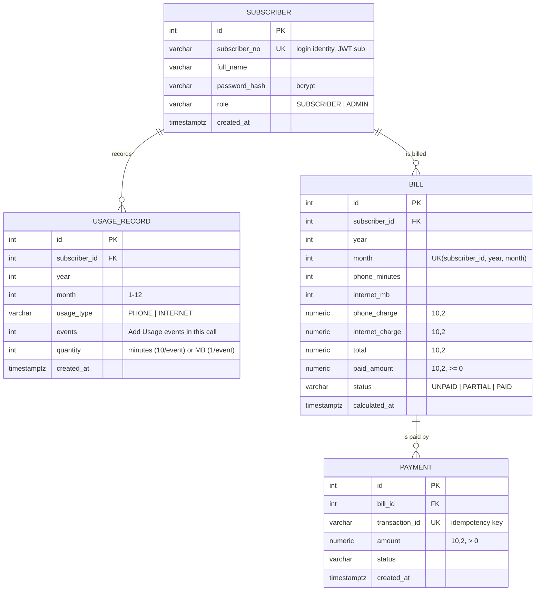

# ER / Data Model

Server database: PostgreSQL 16 (Docker locally, Azure Database for PostgreSQL Flexible Server in the cloud).
Schema is managed by Alembic (`services/billing_api/alembic/versions/0001_initial_schema.py`).

## Design notes
- **Money** is `NUMERIC(10,2)`, never floating point.
- **Usage** is stored as integer minutes / MB. Each Add Usage event records a fixed 10 minutes (phone) or 1 MB (internet), per Billing Guide §2.3 and §3.3.
- **One bill per subscriber per month** (unique constraint). Recalculating a bill updates usage and charges but keeps `paid_amount`.
- **Duplicate payments** are prevented by the unique `transaction_id` (Billing Guide §5.3).
- **Remaining balance** (`total − paid_amount`) and **due date** (month end + 15 days, §6.1) are derived, not stored.
